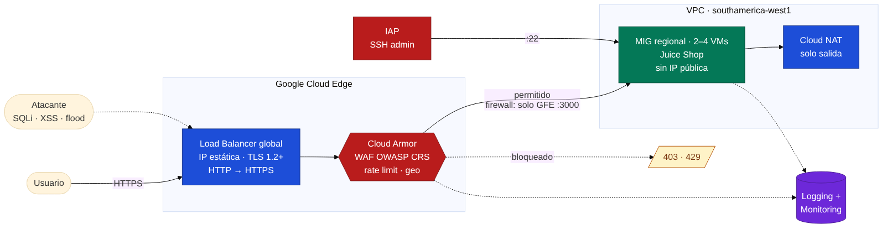
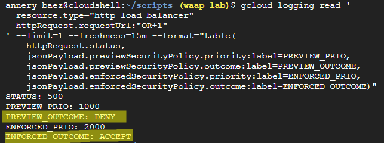
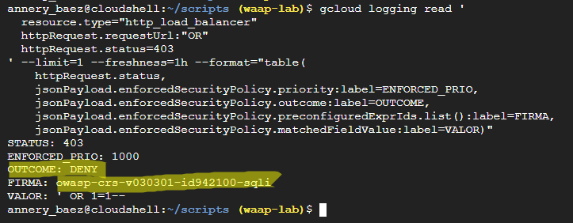
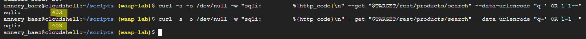
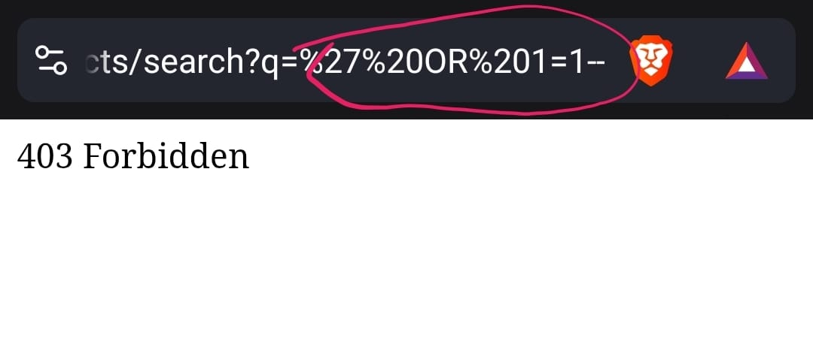
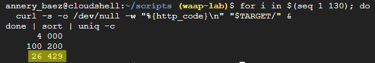
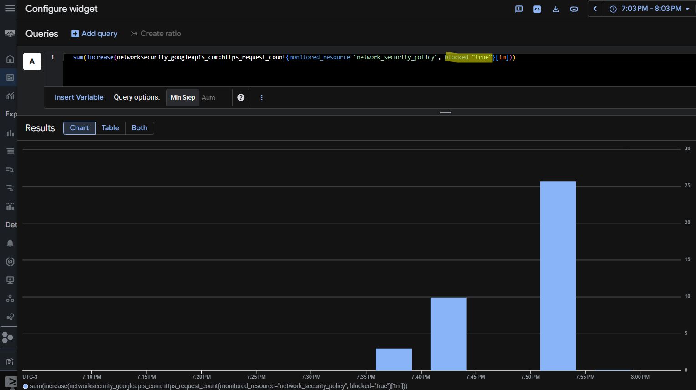

# GCP WAAP Lab: portal web protegido con Cloud Armor


-34A853)


Laboratorio construido **desde cero** en Google Cloud para publicar un portal web detrás de un **Global external Application Load Balancer** y protegerlo con **Cloud Armor** (WAF con OWASP CRS, rate limiting y geo-filtrado), sobre una red diseñada con **mínimo privilegio**.

El backend es **[OWASP Juice Shop](https://owasp.org/www-project-juice-shop/)**, una aplicación vulnerable a propósito. Eso permitió demostrar con ataques reales el comportamiento del WAF **antes y después** de activarlo, y leer en los logs la firma exacta que detuvo cada ataque.

> **Autor:** Aarón Hidalgo Casanga — Cybersecurity Specialist, Application Security
> **Enfoque:** WAAP · edge security · application delivery · defensa en profundidad

---

## Resultados clave

| Prueba | Resultado |
|---|---|
| SQLi `' OR 1=1--` con la regla en **preview** | Detectada por la firma `owasp-crs-v030301-id942100-sqli`, pero permitida: la app respondió **500** (el ataque llegó a la base de datos). |
| La misma SQLi con la regla en **enforcement** | **403** desde `curl` y desde el navegador. La petición ya no llega a la app. |
| 130 peticiones en paralelo (rate limit de 100 req/min por IP) | **100 × 200** y luego **26 × 429**. Las primeras 100 pasan y el resto se banea. |
| Bloqueos de Cloud Armor por minuto | Pico de **26 bloqueos/min** en Cloud Monitoring, que coincide con la prueba de rate limit. |
| Comilla sola `'` en sensibilidad 1 | **200**: no dispara ninguna firma. Hallazgo sobre el equilibrio entre cobertura y falsos positivos (ver abajo). |
| Allowlist de IP en prioridad 100 | **La IP de confianza quedaba fuera del WAF**: una SQLi desde ella llegó a la app. Corregido moviendo la regla a prioridad 1400. |

---

## Arquitectura



> Fuente editable: [`diagrams/arquitectura.mmd`](diagrams/arquitectura.mmd) · [SVG](diagrams/arquitectura.svg)

**Petición legítima:**
`Cliente → DNS → IP estática → Forwarding rule :443 → Target HTTPS proxy (TLS 1.2+) → Cloud Armor → URL map → Backend service → MIG (Juice Shop)`

**Ataque:** se detiene en Cloud Armor con `403` (firma WAF) o `429` (rate limit) y **nunca llega** al backend.

### Capas de defensa

| Capa | Control | Qué evita |
|---|---|---|
| **Borde** | Cloud Armor: OWASP CRS (SQLi, XSS, LFI, RCE, RFI, scanners, protocol attacks, session fixation), rate-based ban, geo-filtrado | Ataques de capa 7 y abuso de volumen. |
| **Transporte** | Certificado administrado por Google, SSL policy *MODERN* con TLS 1.2 mínimo, redirección HTTP→HTTPS, 0-RTT deshabilitado | Tráfico en claro, protocolos y cifrados débiles, *replay*. |
| **Red** | VMs **sin IP pública**; firewall que solo admite rangos de Google Front End y health checks (`35.191.0.0/16`, `130.211.0.0/22`) en el puerto 3000; deny-all explícito con log | Acceso directo a los backends saltándose el WAF. |
| **Administración** | SSH solo por **IAP** (`35.235.240.0/20`), OS Login, llaves de proyecto bloqueadas | Bastiones expuestos y llaves SSH sueltas. |
| **Cómputo** | Shielded VM (Secure Boot, vTPM, Integrity Monitoring), cuenta de servicio con solo `logWriter` y `metricWriter` | Persistencia en el arranque y escalada desde una VM comprometida. |
| **Salida** | Cloud NAT solo de salida, con logging | Exposición entrante; deja registro de destinos contactados. |
| **Observabilidad** | Logging al 100 % en el balanceador, Cloud Armor en **VERBOSE**, dashboard y alerta | Ataques que pasan sin que nadie los vea. |

### Servicios de GCP y su equivalente en F5

| Servicio GCP | Función en el lab | Equivalente F5 |
|---|---|---|
| Cloud Armor (backend security policy) | WAF, rate limiting, geo | ASM / F5 XC App Firewall + Service Policies |
| Preconfigured WAF rules + sensibilidad | Firmas OWASP CRS por categoría | Attack signature sets + accuracy |
| Preview mode (por regla) | Monitoreo sin bloquear | Staging / Transparent |
| Global external Application LB | Terminación TLS y enrutamiento L7 | Virtual Server + perfil Client-SSL |
| Backend service + health check | Pool, monitor y punto de anclaje del WAF | Pool + health monitor / Origin pool |
| MIG regional | Backends autoescalables en 3 zonas | Miembros del pool |

---

## Evidencias

### 1. Antes: regla en preview (detecta sin bloquear)

La misma petición deja dos registros en el log: lo que la regla **habría** hecho (`previewSecurityPolicy`) y lo que **realmente** se aplicó (`enforcedSecurityPolicy`).



```
STATUS: 500
PREVIEW_PRIO: 1000        PREVIEW_OUTCOME: DENY
ENFORCED_PRIO: 2000       ENFORCED_OUTCOME: ACCEPT
```

Con logging **VERBOSE**, Cloud Armor indica la firma, el parámetro y el valor exacto que la activó, el mismo análisis que se hace con un *support ID* en F5:



| Campo | Valor |
|---|---|
| `preconfiguredExprIds` | `owasp-crs-v030301-id942100-sqli` |
| `matchedFieldName` / `matchedFieldType` | `q` / `ARG_VALUES` |
| `matchedFieldValue` | `' OR 1=1--` |
| `preview` | `true` |

### 2. Después: regla en enforcement (bloquea)





### 3. Rate limiting

130 peticiones en paralelo contra un límite de 100 req/min por IP:



```
100 200   ← dentro del umbral
 26 429   ← baneadas (Too Many Requests)
  4 000   ← curl no alcanzó a completarlas por lanzar 130 en paralelo; no son respuestas del WAF
```

### 4. Observabilidad

Bloqueos de Cloud Armor **por minuto**, con PromQL sobre la métrica nativa:

```promql
sum(increase(networksecurity_googleapis_com:https_request_count{monitored_resource="network_security_policy", blocked="true"}[1m]))
```



---

## Hallazgos y lecciones aprendidas

### 🔴 Una allowlist mal ubicada saca a la IP de confianza del WAF

La regla que permitía la IP de pruebas estaba en **prioridad 100**, antes que las firmas. En Cloud Armor una regla `allow` **termina la evaluación**, así que una SQLi enviada desde esa IP llegó a la aplicación (HTTP 500) aunque la regla SQLi ya estaba en enforcement. El log mostró la regla 100 como la que decidió.

**Corrección:** mover la allowlist a **prioridad 1400**, después de las firmas WAF (1000–1070) y antes del geo-filtrado (1500) y el rate limit (2000). La IP sigue exenta de las reglas de volumen y país, pero **el WAF la inspecciona igual**.

**En producción:** una allowlist de oficinas, proveedores o monitoreo puesta antes de las firmas crea un punto ciego. Si una de esas IPs se ve comprometida, el atacante entra sin inspección. Es el mismo riesgo que marcar una IP como *Never block* en ASM.

### 🟡 La sensibilidad 1 no detecta caracteres sueltos

Una comilla sola (`?q='`) **no dispara** las firmas SQLi en sensibilidad 1 (paranoia level 1 del CRS). La detección principal (`942100`, basada en *libinjection*) necesita una estructura SQL reconocible; las firmas que reaccionan a caracteres sueltos (`942110`, `942430`) empiezan en el nivel 2. La tautología `' OR 1=1--` sí se detecta.

Es el equilibrio que hay que decidir en cada WAF: subir la sensibilidad aumenta la cobertura, pero también los falsos positivos.

### 🟡 Preview no se lee donde parece

Las coincidencias en preview **no** aparecen en `enforcedSecurityPolicy`, sino en `previewSecurityPolicy`. Como la regla de rate limit tiene `match: true`, aparece como "enforced" en casi todo el tráfico legítimo (`RATE_LIMIT_THRESHOLD_CONFORM` = bajo el umbral), lo que puede confundirse con un baneo. Filtro correcto:

```
jsonPayload.previewSecurityPolicy.outcome="DENY"
```

### 🟡 Las métricas nativas de Cloud Armor no traen la regla

`networksecurity.googleapis.com/https/request_count` solo tiene las etiquetas `blocked` y `backend_target_name`. Para ver bloqueos **por regla** hace falta una **métrica basada en logs** que extraiga `jsonPayload.enforcedSecurityPolicy.priority`. Además, Metrics Explorer muestra los contadores como tasa por segundo; con `increase(...[1m])` en PromQL se obtiene la cantidad por minuto.

### ⚙️ Diferencias de la consola frente a la documentación habitual

| Paso | Qué cambió | Cómo se resolvió |
|---|---|---|
| Plantilla de instancia | `block-project-ssh-keys` ya no se acepta como metadato libre. | Casilla **Block project-wide SSH keys** en la sección SSH Keys. |
| MIG regional | La plantilla regional no aparece si *Location* está en otra región. | Configurar *Location* antes de elegir la plantilla. |
| MIG regional | *Even* exige desactivar la reparación en zona alternativa. | **Balanced**: reparte igual cuando hay capacidad y no falla si una zona se queda sin ella. |
| Health check | Por defecto viene en TCP. | **HTTP** en `/`: valida que la app responda 200, no solo que el puerto esté abierto. |
| Balanceador | La SSL policy no se puede crear desde el asistente. | Crearla aparte (*MODERN*, TLS 1.2) y asociarla al target proxy. |
| Balanceador | Un frontend :80 manual choca con la casilla de redirect (*"IP address is in-use"*). | Un solo frontend HTTPS :443 con **Enable HTTP to HTTPS redirect**. |

---

## Cómo reproducirlo

La guía documenta **cada click de la consola y la función que cumple**, con su equivalente en `gcloud`:

| # | Fase | Contenido |
|---|---|---|
| 0 | [Prerrequisitos](docs/00-prerequisitos.md) | Proyecto, presupuesto, APIs, dominio |
| 1 | [Red](docs/01-red.md) | VPC custom, firewall de mínimo privilegio, Cloud NAT |
| 2 | [Cómputo](docs/02-computo.md) | Cuenta de servicio, plantilla endurecida, health check, MIG regional |
| 3 | [Load Balancer](docs/03-load-balancer.md) | ALB global, IP estática, certificado administrado, HTTP→HTTPS |
| 4 | [Cloud Armor](docs/04-cloud-armor.md) | Política, reglas OWASP CRS, rate limit, geo, allowlist, logging VERBOSE |
| 5 | [Validación](docs/05-pruebas.md) | Preview → enforcement, lectura de firmas en logs |
| 6 | [Observabilidad](docs/06-observabilidad.md) | Dashboard, métrica basada en logs, alerta |
| 7 | [Limpieza](docs/07-limpieza.md) | Destrucción ordenada para detener el gasto |

Despliegue por CLI (Fases 1–4):

```bash
cp scripts/00-variables.sh.example scripts/00-variables.sh   # editar PROJECT_ID y DOMAIN
source scripts/00-variables.sh
bash scripts/deploy.sh                       # red, cómputo, balanceador y Cloud Armor
bash scripts/test-waf.sh "https://$DOMAIN"   # validación del WAF
gcloud projects delete "$PROJECT_ID"         # limpieza
```

Todos los scripts pasan `shellcheck`. `test-waf.sh` cubre además las sondas de XSS, path traversal y RCE para quien reproduzca el lab.

---

## Costos y limpieza

El lab se montó y destruyó en el mismo día, borrando el proyecto completo. El costo lo dominan la regla de forwarding del balanceador y la IP estática, que cobran por hora aunque no haya tráfico. El presupuesto con alertas se configuró antes de crear cualquier recurso.

> ⚠️ Juice Shop es vulnerable por diseño. Si reproduces el lab, mantén el WAF activo mientras esté publicado y destruye todo al terminar.

---

## Mejoras futuras

- **Cloud Armor Enterprise** con *Adaptive Protection* (detección de DDoS L7 con ML) y *Threat Intelligence*.
- **JSON parsing** en la política para inspeccionar campo por campo los cuerpos de la API (por ejemplo, el login de Juice Shop).
- Migrar *VPC firewall rules* a **Network firewall policies**.
- **mTLS en el frontend** del balanceador.
- Infraestructura como código con **Terraform** y validación con `checkov`.
- Ajuste de **sensibilidad 2** en SQLi con *rule tuning* documentado de falsos positivos.

---

## Licencia

[MIT](LICENSE). Uso educativo.
